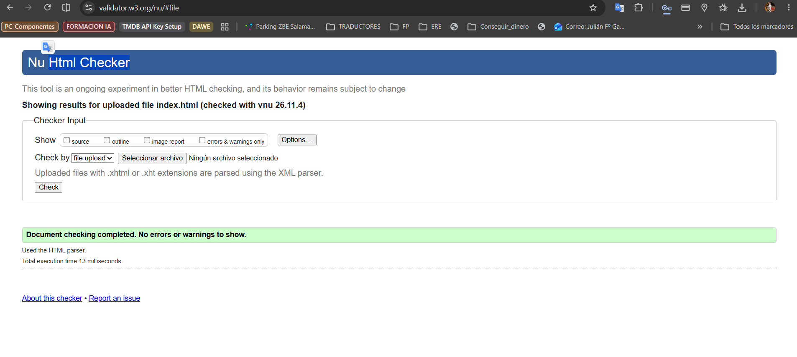
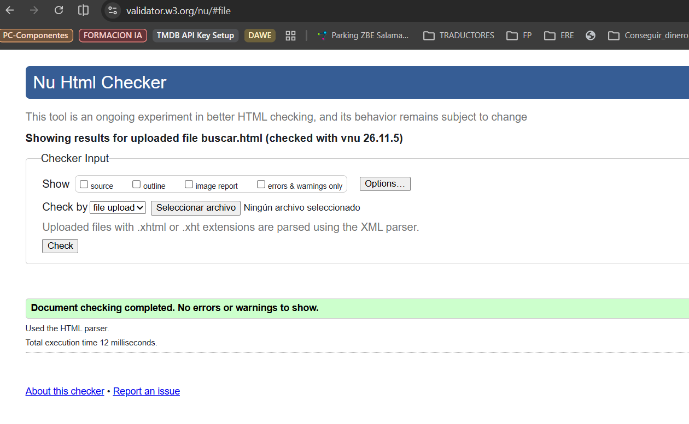
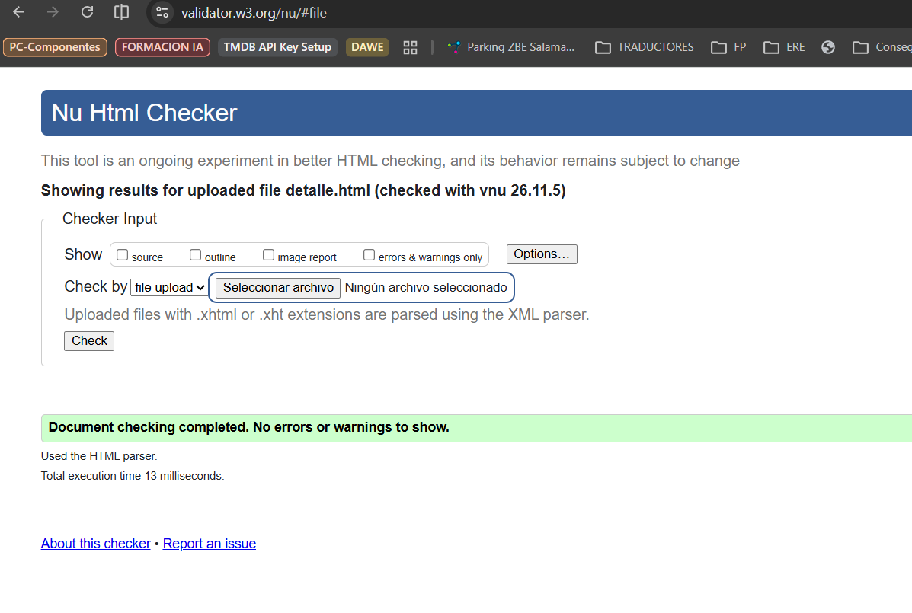
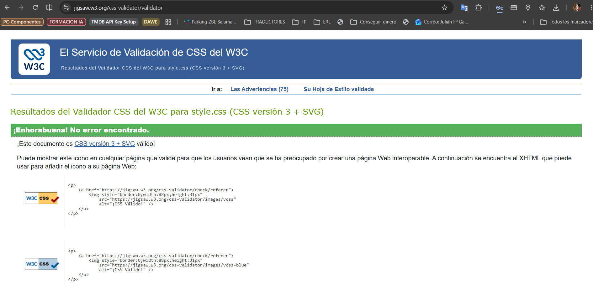

# STREAMIA · Práctica RA2 (DIW · 2.º DAW)

Maquetación de **STREAMIA**, la plataforma de streaming diseñada en Figma en la práctica RA1, con **HTML5 semántico**, **Bootstrap 5.3 en local**, **Sass modular** y **JavaScript**.

- Diseño de referencia: [Figma · DIW Práctica 1 · Streamia](https://www.figma.com/design/BMkYlQUDnbPzFvJu2SdLTs/DIW---Pr%C3%A1ctica-1---Streamia---Juli%C3%A1n-Garc%C3%ADa) (wireframes + pantallas finales + UI Kit).
- Autor: Julián García.

## Páginas

| Página | Contenido |
|---|---|
| `index.html` | Inicio: película destacada y filas desplazables (Tendencias ahora, Seguir viendo, Recomendaciones). |
| `buscar.html` | Búsqueda por título y filtros por tipo (Todos, Películas, Series) y género. También muestra "Mi lista" (`?lista=mi-lista`). |
| `detalle.html` | Ficha **dinámica** de cualquier título: `detalle.html?id=dune-parte-dos`. Sin parámetro muestra *Senderos de gloria*. |

Todas comparten la cabecera con **menú hamburguesa**, el botón de **modo claro/oscuro** y el **formulario de acceso con validación** (botón *Perfil*, modal con *Iniciar sesión* y *Crear cuenta*).

## Estructura del proyecto

```text
Practica_RA2/
├── index.html · buscar.html · detalle.html
├── css/
│   └── style.css              ← CSS compilado (no se edita a mano)
├── scss/
│   ├── style.scss             ← punto de entrada
│   ├── _variables.scss        ← tokens del UI Kit + override de Bootstrap
│   ├── _mixins.scss           ← desde(), foco-visible(), transicion()…
│   ├── _temas.scss            ← hoja alternativa: modo claro / oscuro
│   ├── _fuentes.scss          ← Inter en local
│   ├── _base.scss
│   ├── _header.scss
│   ├── _botones.scss
│   ├── _hero.scss
│   ├── _cards.scss
│   ├── _filas.scss
│   ├── _formularios.scss
│   ├── _buscar.scss
│   ├── _detalle.scss
│   ├── _footer.scss
│   └── bootstrap/             ← código fuente Sass de Bootstrap 5.3.8
├── js/
│   ├── bootstrap.bundle.min.js  ← incluye Popper (menú hamburguesa, modal…)
│   ├── catalogo.js              ← datos de las 12 películas y 7 series
│   └── script.js                ← lógica propia
├── fonts/                     ← Inter 400 · 500 · 700 (woff2)
├── img/                       ← 19 carteles (600 × 900) + fotograma del destacado
├── capturas/                  ← capturas de la validación W3C
└── .vscode/settings.json      ← configuración de Live Sass Compiler
```

## Decisiones técnicas

- **Mobile-first**: los estilos base son para móvil y se amplían con el mixin `desde(md)`, `desde(lg)`… que usa los breakpoints de Bootstrap.
- **Grid de 12 columnas**: destacado (`col-12 col-md-6`), filas (`row flex-nowrap` con `col-9 col-sm-6 col-md-4 col-lg-3 col-xl-2`), resultados (`row-cols-1 … row-cols-xxl-6`) y ficha de detalle (`order-*` para reordenar en móvil).
- **Override de Bootstrap**: las variables de `_variables.scss` se importan **antes** que Bootstrap (`$primary`, tipografía, radios, botones…). Los botones se personalizan con las variables CSS de Bootstrap 5.3 (`--bs-btn-*`), **sin `!important`**.
- **Solo los módulos necesarios** de Bootstrap se importan en `style.scss`.
- **Microinteracciones**: `:hover`, `:focus-visible` y `:focus-within` siguiendo los estados del UI Kit (botones, input de búsqueda y tarjetas).
- **Tema claro por defecto** y **tema oscuro** (el de Figma). `script.js` alterna el atributo `data-bs-theme` de `<html>` y lo guarda en `localStorage`; `_temas.scss` genera las variables `--st-*` de cada tema a partir de dos mapas de Sass.
- **Catálogo** (`js/catalogo.js`): las 12 películas y 7 series del proyecto (año, duración o temporadas, dirección o creación, reparto, argumento, género y cartel), generado a partir de las hojas de cálculo del catálogo. Es un `.js` y no un `.json` para que la web funcione también abriéndola sin servidor.
- **Ficha dinámica**: `detalle.html` es una sola página. `script.js` lee el parámetro `id` de la URL, busca el título en `CATALOGO` y rellena título, datos, cartel, argumento y ficha técnica creando los `<dt>`/`<dd>` con el DOM. Las recomendaciones relacionadas (mismo género) se crean clonando un `<template>`. Si el `id` no existe se muestra un aviso.
- **JavaScript y DOM** (`js/script.js`): modo claro/oscuro, validación de formularios (`checkValidity`, `was-validated`, comprobación de contraseñas con `setCustomValidity`), botones *Mi lista*, búsqueda y filtros en vivo y aviso del botón *Reproducir* (toast de Bootstrap).
- **Accesibilidad**: enlace "Saltar al contenido", `aria-current`, `aria-pressed`, `aria-live` en el contador de resultados, textos alternativos y foco visible con teclado.

## Cómo compilar el Sass

### Opción A · Live Sass Compiler (VS Code)

1. Instala la extensión **Live Sass Compiler** (Glenn Marks).
2. Abre la carpeta del proyecto en VS Code. La configuración ya está en `.vscode/settings.json`:
   - compila **solo** `scss/style.scss`,
   - guarda el resultado en `css/style.css`,
   - ignora la carpeta `scss/bootstrap/`.
3. Pulsa **Watch Sass** en la barra inferior.

> Al compilar aparecen avisos *deprecation warning* que proceden del código de Bootstrap 5.3 (uso de `@import` y funciones antiguas de Sass). Son avisos, no errores: el CSS se genera correctamente.

### Opción B · Terminal

```bash
npx sass --no-source-map --quiet-deps scss/style.scss css/style.css
```

## Validación W3C

| Validador | Resultado |
|---|---|
| [HTML · validator.w3.org](https://validator.w3.org/) (`index.html`, `buscar.html`, `detalle.html`) | Sin errores |
| [CSS · jigsaw.w3.org](https://jigsaw.w3.org/css-validator/) (`css/style.css`) | Sin errores |






## Correcciones respecto al diseño de Figma

- Erratas corregidas: *Ver ahoras* → **Ver ahora**, *Un cruda historia de las consecuencias de la gerra* → **Una cruda historia sobre las consecuencias de la guerra a nivel personal**.
- Se ha eliminado el texto de trabajo "Wireframe de la pantalla Inicio de Streamia" que aparecía en las pantallas finales.
- Los emojis ☰ 👤 del móvil se sustituyen por el botón hamburguesa de Bootstrap y un icono SVG de perfil, con el contraste adecuado en ambos temas.
- Los marcadores "IMAGEN/POSTER" del UI Kit se sustituyen por los carteles reales, manteniendo la tarjeta morada y la línea discontinua.
- Las filas de Inicio son desplazables (síntesis de los wireframes, con 12 películas por fila, y de las pantallas finales).
- El texto del input de búsqueda usa `#3F3F46` en lugar de blanco para que se lea sobre el fondo `#D9D9D9`.
